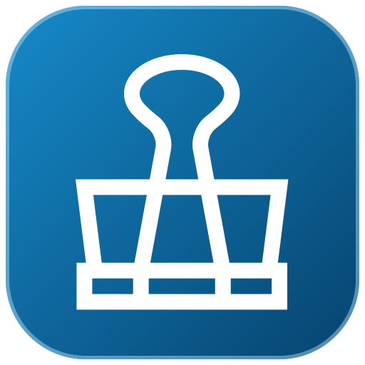
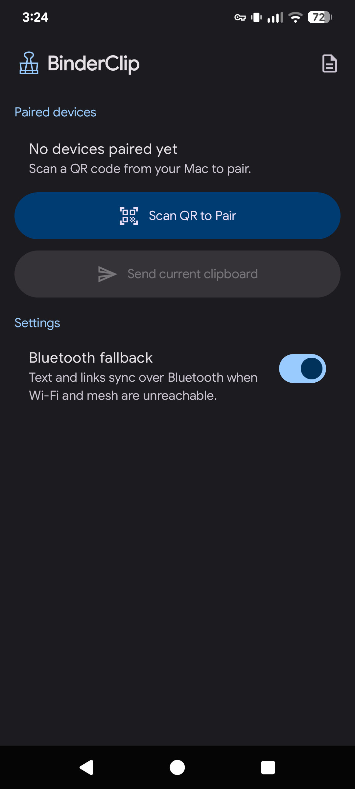

<p align="center"></p>

<h1 align="center">BinderClip</h1>

<p align="center">The most toughest clipboard sync for rooted Android phones and Mac over your local network, mesh VPN, or Bluetooth.</p>

<p align="center">AI disclosure: Human validated.</p>


## Preview

<p align="center">
  <a href="docs/images/android-app.png"></a>
</p>

## Features

- Automatic clipboard sync for text and images up to 30 MiB
- Share text, images, and browser links from Android to Mac; send the current Mac browser tab to your phone
- Encrypted, replay-resistant connections over LAN, mesh VPN, and Bluetooth (protocol 3)
- Sleep-aware background sync and automatic reconnection
- macOS updates in the app; Android updates through [Obtainium](https://obtainium.imranr.dev/)
- Available in **9 languages**: English, Indonesian, Spanish, Simplified Chinese, Japanese, German, French, Portuguese, and Russian

## Install

Requires **macOS 13 or later** and **Android 12 or later**. Android also requires [KernelSU](https://kernelsu.org/) or [Magisk](https://github.com/topjohnwu/Magisk) root. Download the apps from [GitHub Releases](https://github.com/bgwastu/BinderClip/releases).

### Mac — option 1: Terminal

For a fresh install, run this in an empty folder. It finds the newest available Mac ZIP, installs the app in `/Applications`, and opens it:

```sh
curl -fL -o BinderClip.zip \
  "$(curl -fsSL 'https://api.github.com/repos/bgwastu/BinderClip/releases?per_page=100' \
    | grep -Eo 'https://[^"]+/BinderClip-[^"]+\.zip' | head -n 1)" \
  && unzip -q BinderClip.zip \
  && xattr -cr BinderClip.app \
  && mv BinderClip.app /Applications/ \
  && rm BinderClip.zip \
  && open /Applications/BinderClip.app
```

**Why `xattr -cr`?** The Mac release is ad hoc signed and is not notarized by Apple. This command recursively clears extended attributes, including the download quarantine flag, so macOS can open this copy of the app. For later updates, use BinderClip’s in-app updater.

### Mac — option 2: no Terminal

1. From [Releases](https://github.com/bgwastu/BinderClip/releases), download the newest `BinderClip-*.dmg` and open it. Some releases contain only Android updates, so choose the newest release with a Mac DMG.
2. Drag **BinderClip.app** into **Applications**, then try to open it.
3. If macOS blocks it, open **System Settings → Privacy & Security**, scroll to **Security**, click **Open Anyway**, then confirm **Open**. The button appears after the first blocked launch. See [Apple’s instructions](https://support.apple.com/en-ie/102445).

### Android and pairing

1. Download the newest `BinderClip-*.apk` from [Releases](https://github.com/bgwastu/BinderClip/releases) and install it on the rooted phone.
2. Open BinderClip, grant root access, and allow notifications when prompted. Bluetooth permission is only needed if you enable Bluetooth fallback.
3. On the Mac, choose **Add Device** from the BinderClip menu bar icon. On Android, tap **Scan QR to Pair** and scan the code.


## Acknowledgments

Thanks to [ClipRelay](https://github.com/geekflyer/cliprelay) for the initial implementation and inspiration.
