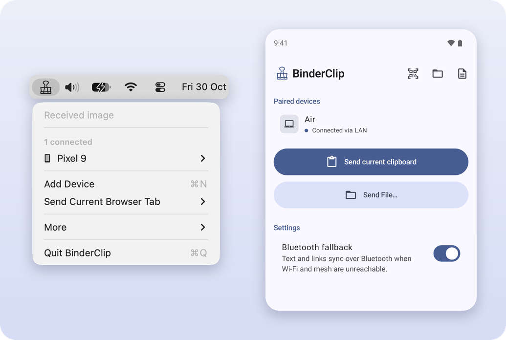

# BinderClip

Sync your clipboard and share files between Android and Mac over your local network or mesh VPN. Bluetooth also supports text and links.

<picture>
  <source media="(prefers-color-scheme: dark)" srcset="assets/binderclip-preview-dark.png">
  
</picture>

## Install

Requires an Apple Silicon Mac with macOS 13 or later and a phone with Android 12 or later. Download the Mac DMG and Android APK from the [latest release](https://github.com/bgwastu/binderclip/releases/latest).

1. Open the DMG and drag BinderClip into Applications. If macOS blocks the first launch, use **Open Anyway** in **System Settings → Privacy & Security**.
2. Install the APK and open BinderClip on Android. Allow notifications when prompted.
3. Choose **Add Device** from the Mac menu bar icon. Tap **Scan QR to Pair** on Android and scan the code.

Automatic Android-to-Mac clipboard sync requires root or [Shizuku](https://shizuku.rikka.app/). The Android setup screen guides you through Shizuku. Receiving clipboard items and sharing files work without it.

## Use

- Incoming clipboard items replace your clipboard by default. Turn off **Automatically replace clipboard** to copy them manually.
- Share files from either device and check their status in **Transfers**. Files received on Mac go to `~/Downloads/BinderClip`.
- Check for updates in BinderClip. On Android, you can also track this repository with [Obtainium](https://obtainium.imranr.dev/).

Based on [ClipRelay](https://github.com/geekflyer/cliprelay). AI-assisted and human-validated.
